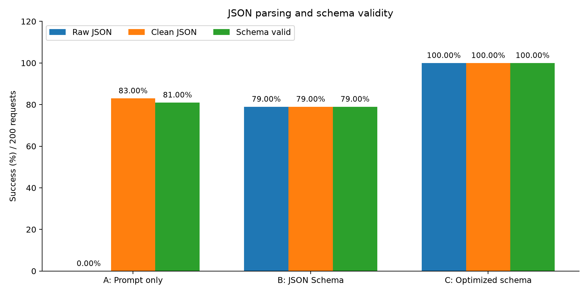
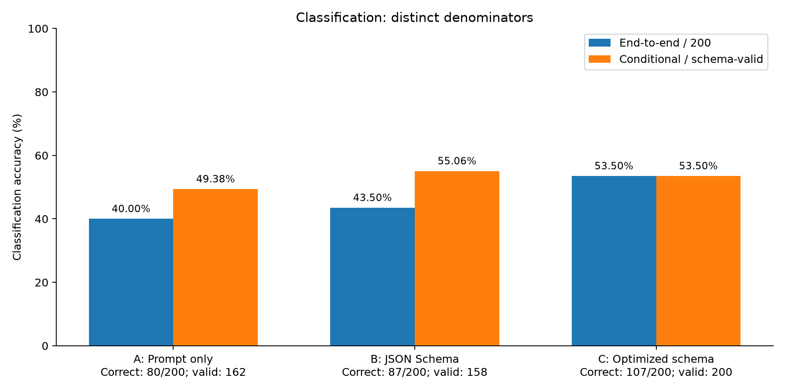
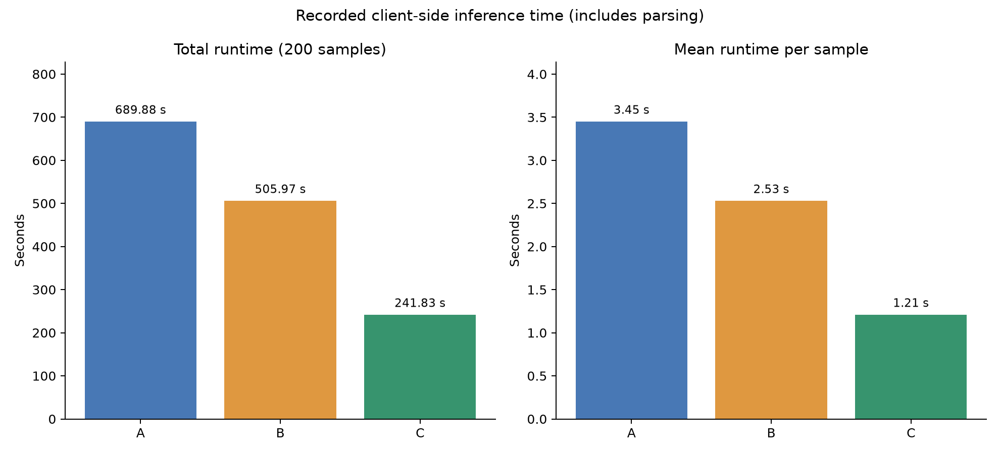
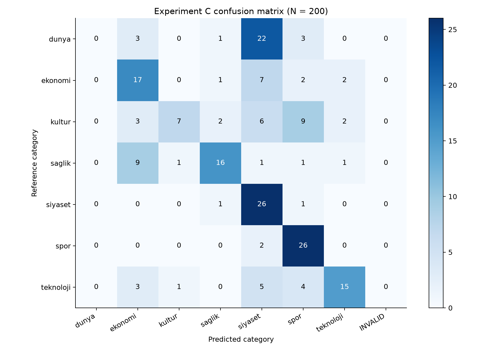
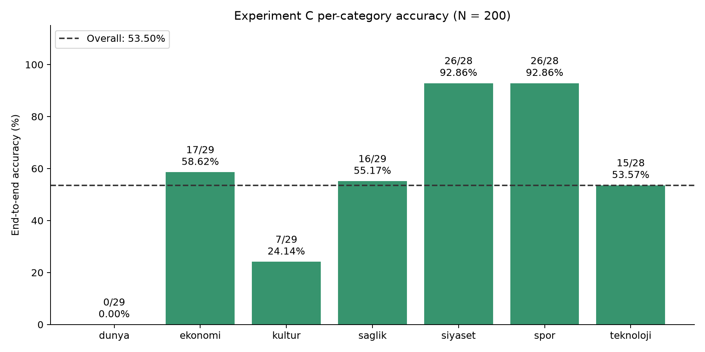
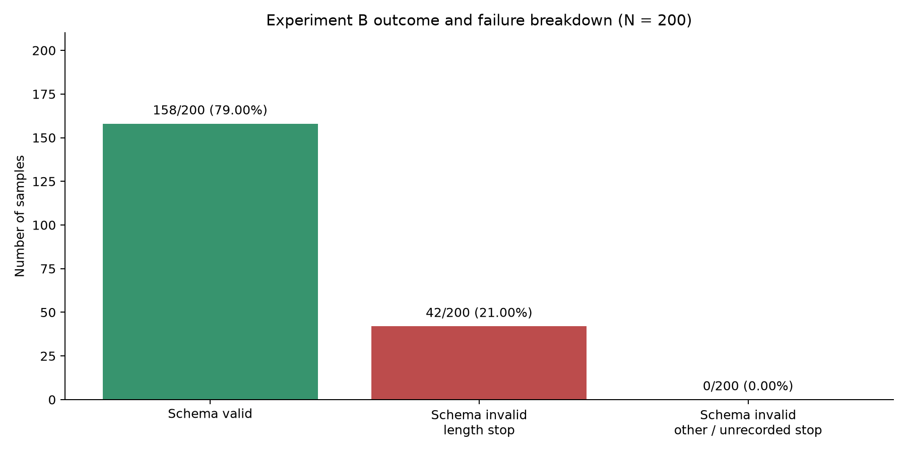

# Structured Text Classification and Information Extraction

This project evaluates a local `qwen2.5:3b` model on Turkish TTC4900 news. The completed evaluation contains **200 records per experiment**, with five separate development records. All three experiments use exactly the same ordered evaluation IDs and each received 200 responses with zero API errors.

## Dataset and experimental boundary

The canonical dataset is [data/test_samples.jsonl](data/test_samples.jsonl): **205 records**, in preserved order. Development is `samples[:5]`; evaluation is exactly `samples[5:205]`. IDs and text were not changed after inference.

There are **200 unique evaluation record IDs but 199 unique evaluation texts**. IDs **2138 and 2296** contain identical text. Across all 205 records there are 204 unique texts. Results are record-level measurements; no post-inference deduplication was performed. Evaluation support is 29 each for `dunya`, `ekonomi`, `kultur`, `saglik`, and 28 each for `siyaset`, `spor`, `teknoloji`.

[data/test_samples_manifest.json](data/test_samples_manifest.json) records dataset provenance, seed 42, membership, order and hashes. Selection uses the TTC4900 `train` source, a 150–3000 character filter, and a deterministic quota extension of the original ordered selection. Reading that source split does not train the model.

## Methods and preserved settings

- **A — Prompt only:** detailed Turkish prompt, without generation-time schema enforcement.
- **B — JSON Schema:** same prompt as A, with `format=JSON_SCHEMA`.
- **C — Optimized schema:** shorter prompt, the same JSON Schema, `repeat_penalty=1.2`, `repeat_last_n=128`.

All three use `temperature=0`, `seed=42`, `num_ctx=4096`, `num_predict=384`, `stream=False`, and `timeout=(5, 60)`. `top_k` and `top_p` are not explicitly configured. The recorded Ollama version is `0.40.2`; model digest and source/dataset hashes are in [results/run_identity.json](results/run_identity.json). Model parameter metadata was null; hardware/GPU utilization was not remeasured during migration.

The schema requires one of seven categories and `person`, `organization`, `location` arrays of strings, with no extra fields. The maximum of five entities is a prompt instruction, not a schema constraint. Migration preserved the executed algorithms, prompt strings, JSON Schema, parsing, validation, exception handling and inference options. Hash and AST comparison evidence is in [docs/migration_manifest.json](docs/migration_manifest.json).

## Results

All numbers below are recomputed from stored raw responses. Main rates divide by **200**, including failed outputs. Conditional accuracy divides by the number of schema-valid outputs.

| Metric | A: Prompt only | B: JSON Schema | C: Optimized schema |
|---|---:|---:|---:|
| Raw JSON | 0/200 (0.00%) | 158/200 (79.00%) | 200/200 (100.00%) |
| Clean JSON | 166/200 (83.00%) | 158/200 (79.00%) | 200/200 (100.00%) |
| Schema valid | 162/200 (81.00%) | 158/200 (79.00%) | 200/200 (100.00%) |
| Correct category | 80/200 (40.00%) | 87/200 (43.50%) | 107/200 (53.50%) |
| Conditional accuracy | 80/162 (49.38%) | 87/158 (55.06%) | 107/200 (53.50%) |
| Total time (s) | 689.88 | 505.97 | 241.83 |
| Mean time (s) | 3.45 | 2.53 | 1.21 |

Source: [results/metrics_summary.json](results/metrics_summary.json). The three JSONL result files are canonical and contain exactly 200 unique article IDs each:

- [Prompt-only responses](results/improved_prompt_results.jsonl)
- [Schema responses](results/schema_results.jsonl)
- [Optimized-schema responses](results/optimized_schema_results.jsonl)

A has 34 outputs unparseable after cleaning and four parsed outputs that fail the schema. C has 200 structurally valid outputs but 93 incorrect categories. Its 53.50% accuracy does not imply semantic entity correctness. C changes both the prompt and repetition settings, so their individual effects are not isolated.

The [C confusion matrix](results/v3_confusion_matrix.csv), [A matrix](results/confusion_matrix_A.csv) and [B matrix](results/confusion_matrix_B.csv) each total 200. Rows are reference categories; columns are predictions, with an additional `INVALID` failure column.

## Figures and report

The six figures are regenerated from the same saved responses in PNG and SVG:













The academic [report.pdf](report.pdf) distinguishes five development samples from 200 evaluation samples, states all denominators, and discusses duplicate text, class errors, runtime and limitations. Entity arrays are audited only for structure, repetition and length; no semantic NER F1 or hallucination rate is claimed.

## Run and reproduce

The main entry point is `python src/step3_run_experiments.py`. With the project environment activated, the numbered files describe the pipeline in execution order:

| Step | Python file in `src/` | Purpose |
|---|---|---|
| 1 | `step1_prepare_dataset.py` | Reproduce and verify the frozen 205-record selection; the included dataset is already prepared. |
| 2 | `step2_test_model.py` | Optional single development-sample connection test; makes a real Ollama request. |
| 3 | `step3_run_experiments.py` | Validate checkpoints and orchestrate A, then B, then C; the completed submission exits without inference. |
| 3a | `step3a_evaluate_prompt.py` | Experiment A: prompt-only generation for the 200 evaluation records. |
| 3b | `step3b_evaluate_json.py` | Experiment B: the same prompt with JSON Schema enforcement. |
| 3c | `step3c_evaluate_optimized.py` | Experiment C: shorter prompt and repetition settings with the same schema. |
| 4 | `step4_analyze_results.py` | Recompute metrics and confusion matrices from stored responses. |
| 5 | `step5_generate_figures.py` | Refresh analysis and generate six PNG/SVG figure pairs. |
| 6 | `step6_build_report.py` | Refresh analysis/figures and build the academic PDF. |
| 7 | `step7_verify_project.py` | Check saved records, metrics, hashes, matrices, figures and report without inference. |
| 8 | `step8_package_submission.py` | Run verification and create the validated submission ZIP. |
| Development | `dev_evaluate_baseline.py` | Separate five-record baseline; excluded from the main A/B/C evaluation. |

For a presentation of this completed project, run steps 3 and 7 and show the saved report/figures. Step 2 and the development baseline are not needed. Steps 4–6 reproduce artifacts from saved responses; they are not needed merely to verify the submission. Step 8 prepares the delivery archive.

From the project root, with Python and the dependencies in `requirements.txt`:

```bash
python -m venv venv
venv/bin/python -m pip install -r requirements.txt
venv/bin/python src/step3_run_experiments.py
venv/bin/python src/step6_build_report.py
venv/bin/python src/step7_verify_project.py
venv/bin/python -m unittest discover -s tests -v
```

The submitted run is complete: `step3_run_experiments.py` validates it and exits without contacting Ollama or repeating inference. `step6_build_report.py` regenerates metrics, all six figures, and the PDF from saved responses. DejaVu Sans fonts are expected at `/usr/share/fonts/truetype/dejavu`.

For an incomplete checkpoint, the runner checks local Ollama availability, model/dataset/code identity and existing results, then invokes A/B/C sequentially with `--limit 200`. Every completed ID is skipped, including saved errors; no automatic retry is introduced. A malformed JSONL line fails visibly. Use one runner at a time. Direct scripts are `src/step3a_evaluate_prompt.py`, `src/step3b_evaluate_json.py`, and `src/step3c_evaluate_optimized.py`, each defaulting to 200 evaluation records.

For analysis only:

```bash
venv/bin/python src/step4_analyze_results.py
venv/bin/python src/step5_generate_figures.py
```

`src/step1_prepare_dataset.py` replays the original selection and extension algorithm, verifies the manifest hash, and refuses to overwrite different membership/order. It accepts `--source-arrow /path/to/ttc4900-train.arrow` for a local source cache. It is unnecessary for the included, already verified dataset. `src/dev_evaluate_baseline.py` and `src/step2_test_model.py` are development tools; the five baseline development results are separate from the main experiments.

The three evaluation scripts are byte-for-byte unchanged by the filename reorganization. Their introductory docstrings retain the historical runner name `src/run_evaluation.py`; use `src/step3_run_experiments.py` today. The preserved PDF also contains its original reproduction filenames; the table above supplies the current commands. The report, figures, dataset and stored experiment results were not regenerated for this naming change. The historical migration inventory and manifest retain their original filenames; verification maps current evaluation names to those historical identities. Only module keys changed in `results/run_identity.json`, with all hash values preserved.

## Study and validation documents

- [Turkish code study guide](docs/CODE_STUDY_GUIDE_TR.md)
- [Technical Q&A guide](docs/TECHNICAL_QA_TR.md)
- [Presentation preparation](docs/PRESENTATION_PREPARATION_TR.md)
- [Verification summary](docs/VERIFICATION_SUMMARY_TR.md)
- [File-by-file migration changes](docs/MIGRATION_CHANGES.md)
- [Machine-readable verification](docs/verification.json)

The previous project is preserved outside the active repository. Its archive location and checksum inventory are recorded in the migration manifest. The backup includes all old results and a snapshot of the completed source run. The current dataset and all 600 promoted response records are byte-identical to that completed source run. The historical backup is excluded from the submission.

The current submission is `structured-text-project-submission.zip`; it contains this canonical project and excludes the virtual environment, caches, repository metadata, backups and nested archives.
