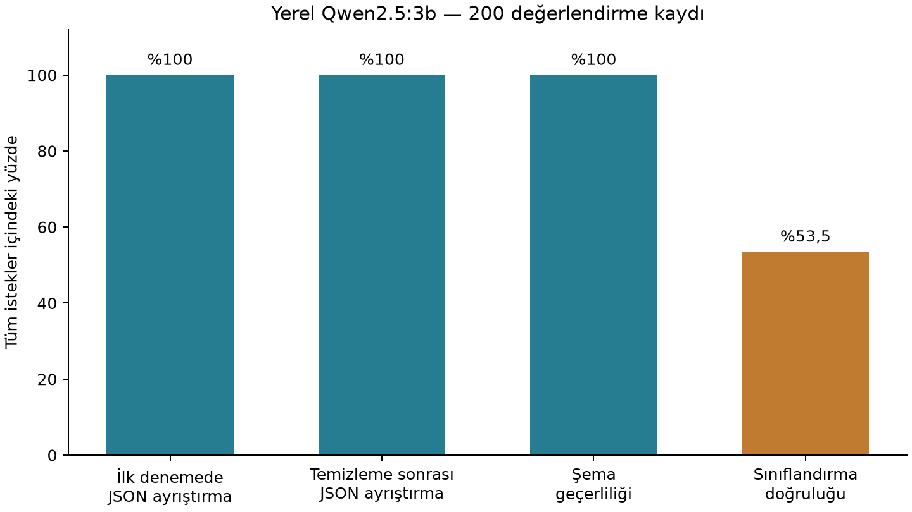

# Proje I: Yapılandırılmış Metin Sınıflandırma ve Bilgi Çıkarımı

Bu Python uygulaması, Türkçe haberleri yedi kategoriye ayırır ve kişi, kurum ve yer adlarını yapılandırılmış JSON biçiminde çıkarır. **Ollama** üzerinden yerel olarak çalışan açık kaynaklı **Qwen2.5:3b** modelini kullanır. Bulut LLM API’si, model eğitimi veya ince ayar (fine-tuning) kullanılmaz.

Dersin gereklilikleri; şemayla sınırlandırılmış üretim, açık JSON temizleme ve `try-except` kullanımı, **kaydedilmiş 200 gerçek yanıtın** değerlendirilmesi, açıklamalı Python kodu, çevrimdışı testler ve kısa teknik raporla karşılanır. Raporun [Türkçe PDF](report/technical_report_tr.pdf) ve [Türkçe Markdown](report/technical_report_tr.md) kopyaları bulunur. Özgün [İngilizce PDF](report/technical_report.pdf) ve [İngilizce Markdown](report/technical_report.md) dosyaları da korunmuştur.

## Dosyalar

```text
 data/test_samples.jsonl                 Sabit veri kümesi: haberler ve referans kategoriler
 src/llm_pipeline.py                     İstem, yerel istek, ayrıştırma ve doğrulama
 src/evaluate.py                         Çevrimdışı analiz veya açıkça başlatılan yeni çıkarım
 results/optimized_schema_results.jsonl  Tamamlanmış çalışmanın değişmemiş özgün yanıtları
 results/summary.json                    Yeniden hesaplanan metrikler
 results/figures/json_success.png        Dört değerlendirme oranı
 report/technical_report.md              Özgün İngilizce rapor
 report/technical_report.pdf             Özgün İngilizce raporun PDF sürümü
 report/technical_report_tr.md           Türkçe rapor kopyası
 report/technical_report_tr.pdf          Türkçe raporun PDF sürümü
 report/figures/json_success_tr.png      Grafiğin Türkçe kopyası
 report/evidence.sha256                  Koruma amaçlı özetler; çalıştırma için gerekmez
 tests/test_pipeline.py                  Çevrimdışı birim ve bütünleştirme testleri
 README.md
 requirements.txt
 .gitignore
```

## Veri kümesi ve model

Sabit TTC4900 seçkisi (`savasy/ttc4900`, train bölümü) 205 kayıttan oluşur: beş geliştirme kaydı ve **`samples[5:205]` dilimindeki 200 değerlendirme kaydı**. Kimlikler, metinler, sıralama ve referans etiketler korunmuştur. Seçimde 42 rastgelelik tohumu, 150–3000 karakter filtresi ve kategori kotaları kullanılmıştır: `dunya`, `ekonomi`, `kultur`, `saglik` için 29’ar; `siyaset`, `spor`, `teknoloji` için 28’er kayıt. Değerlendirmede **200 farklı kayıt kimliği, ancak 199 benzersiz metin** vardır; 2138 ve 2296 kimlikli kayıtlar aynı metni içerir. Hazır veri kümesi depoda bulunduğundan indirme veya hazırlama betiği gerekmez.

Tamamlanmış çalışmada `qwen2.5:3b`, Ollama’nın `format` alanında JSON Schema, `build_prompt()` içindeki Türkçe istem ve aşağıdaki değişmemiş ayarlar kullanılmıştır:

```python
{"temperature": 0, "seed": 42, "num_ctx": 4096, "num_predict": 384,
 "repeat_penalty": 1.2, "repeat_last_n": 128}
```

İstekler `http://localhost:11434/api/generate` adresine, `stream=False` ve `timeout=(5, 60)` ile gönderilir. Zaman aşımı değerleri sırasıyla bağlantı ve okuma beklemelerine uygulanır. Kaydedilmiş ortam bilgisi Ollama sürümünü `0.40.2` olarak belirtir; yeni bir kurulum veya model sürümü aynı çıktıları üretmeyebilir.

## JSON çıktısı ve işlem akışı

Çıktı yapısını gösteren örnek; ek bir deney sonucu değildir:

```json
{
  "category": "spor",
  "entities": {"person": [], "organization": [], "location": []}
}
```

Haber → Türkçe istem → yerel Ollama → ham yanıt → `json.loads()` → gerekirse temizleme → şema doğrulama → referans kategoriyle karşılaştırma → sonucun kaydedilmesi.

`parse_json_response()` önce doğrudan `json.loads(raw_output)` çağırır. `json.JSONDecodeError` oluşursa `clean_json_output()` çağrılır ve ayrıştırma yeniden denenir. Temizleyici, baştaki ve sondaki boşlukları ve Markdown kod çitlerini kaldırır; çevredeki açıklama metinlerini atlamak için ilk ayrıştırılabilir JSON nesnesini bulur. Eksik alan uydurmaz ve kesilmiş JSON’u tamamlamaz. Özgün kurtarma davranışı, kesilmiş metnin içindeki tamamlanmış bir iç nesneyi bulabilir; bu nesne yine de şema doğrulamasından geçmelidir.

`validate_schema()` eksik veya fazla alanları, yedi etiket dışındaki kategorileri ve metin listesi olmayan varlık alanlarını reddeder. İstemde her liste için en fazla beş ad ve tekrarsızlık istenir; bunlar ek şema kuralları değil, istem talimatlarıdır. `evaluate_sample()` bağlantı, HTTP ve API yanıt gövdesi hatalarını kaydeder; sonraki örneğin işlenmesini sağlar. JSON sözdizimi başarısı ve sınıflandırma doğruluğu ayrı değerlendirilir.

## Kurulum ve çevrimdışı analiz

Python 3.10 veya üzerini kullanın. Depo kök dizininde:

```bash
python3 -m venv .venv
source .venv/bin/activate
python -m pip install -r requirements.txt
python src/evaluate.py --analyze
python -m unittest discover -s tests -v
```

Analiz ve testler için Ollama sunucusu veya model gerekmez. `python src/evaluate.py` komutu, parametre verilmediğinde de kayıtlı sonuçları analiz eder. Analiz, başarı bayraklarını ham metinden yeniden hesaplar, kimlikleri ve referans etiketleri denetler; yalnızca `results/summary.json` ile sonuç grafiğini günceller. Eksik veya yinelenen sonuç kimlikleri reddedilir. Ham yanıt dosyaları yeniden yazılmaz.

## Yeni yerel çıkarım çalıştırma

Ollama’yı kurun ve yerel hizmetini başlatın; zaten çalışmıyorsa `ollama serve` kullanın. Ardından modeli indirip yeni çalışmayı açıkça başlatın:

```bash
ollama pull qwen2.5:3b
python src/evaluate.py --run --results results/fresh_run.jsonl
```

Bu komut yerel modele 200 istek gönderir. Çıktı dosyası önceden bulunmamalıdır; komut mevcut dosyanın üzerine yazmayı reddeder. Her sonuç hemen kaydedilir. Yeni özet ve grafik, bu dosyanın yanına yazılır; yayımlanmış sonuçlar korunur. Tamamlanmış yeni bir çalışmayı daha sonra analiz etmek için:

```bash
python src/evaluate.py --analyze --results results/fresh_run.jsonl
```

Kesintiye uğrayan çalışmanın dosyası inceleme için saklanır; ancak tamamlanmamış çalışmalardan nihai metrik üretilmez. Baştan başlatmak için yeni bir dosya adı seçin. Testlerde istekler taklit edilir (mock); **sadeleştirme sırasında yeni model çıkarımı yapılmamıştır**.

## Ölçülen sonuçlar

Aşağıdaki değerler yeni bir deneyden değil, mevcut tamamlanmış çalışmanın yeniden analizinden elde edilmiştir. Özgün yanıt dosyasının adı ve baytları korunmuştur.

| Metrik | Başarılı / tüm istekler | Oran |
|---|---:|---:|
| İlk denemede JSON ayrıştırma | 200 / 200 | **%100** |
| Temizleme sonrası JSON ayrıştırma | 200 / 200 | %100 |
| Şema geçerliliği | 200 / 200 | %100 |
| Sınıflandırma doğruluğu | 107 / 200 | **%53,5** |

200 isteğin tamamına yanıt alınmıştır; API hatası sayısı **0**’dır. Kaydedilen toplam süre **241,83 saniye**, kayıt başına ortalama süre **1,21 saniye**dir. Bu süre, isteğin yanıtını beklemeyi ve yerel ayrıştırmayı kapsar; çevrimdışı analiz çıkarım süresini yeniden ölçmez.

Her oran `başarılı_sayısı / toplam_istek_sayısı * 100` ile hesaplanır. API, ayrıştırma ve şema hataları paydada kalır. İlk deneme başarısı, modelin değiştirilmemiş metninin temizleme öncesinde ayrıştırılabilmesidir. Temizleme sonrası metrik, doğrudan başarılı yanıtları ve kurtarılan yanıtları birlikte içerir; **bu çalışmada hiçbir yanıtın kurtarılması gerekmemiştir**. Sınıflandırma, ancak şema doğrulaması başarılıysa ve tahmin referans etiketle aynıysa doğru sayılır.



## Sınırlılıklar ve korunan kanıtlar

Geçerli JSON, doğru sınıflandırmayı veya varlıkların gerçekliğini garanti etmez. Varlık çıkarımı yapılmıştır; ancak elle etiketlenmiş varlık referansları kullanılmadığından anlamsal varlık doğruluğu ve halüsinasyon tespiti değerlendirilmemiştir. Tekrarlanan bir metin, değerlendirme çeşitliliğini bir miktar azaltır. Bulgular bu veri kümesi ve yapılandırma için geçerlidir.

Sadeleştirme öncesindeki tüm kod ve Git ile izlenen deneyler, [`backup/pre-simplification`](https://github.com/emrehann17/structured-text-project/tree/backup/pre-simplification) dalındaki `f970b0c9bbb622d8e5a6d3ccf5fe4aea90aca7cb` commit’inde korunur. [SHA-256 kayıtları](report/evidence.sha256), değişmemiş veri kümesini ve tüm özgün model yanıt dosyalarını kapsar; geçmiş yanıt dosyaları bu dalda denetlenebilir. Bu özetler koruma kanıtıdır; günlük çalıştırma akışının bir adımı değildir.
