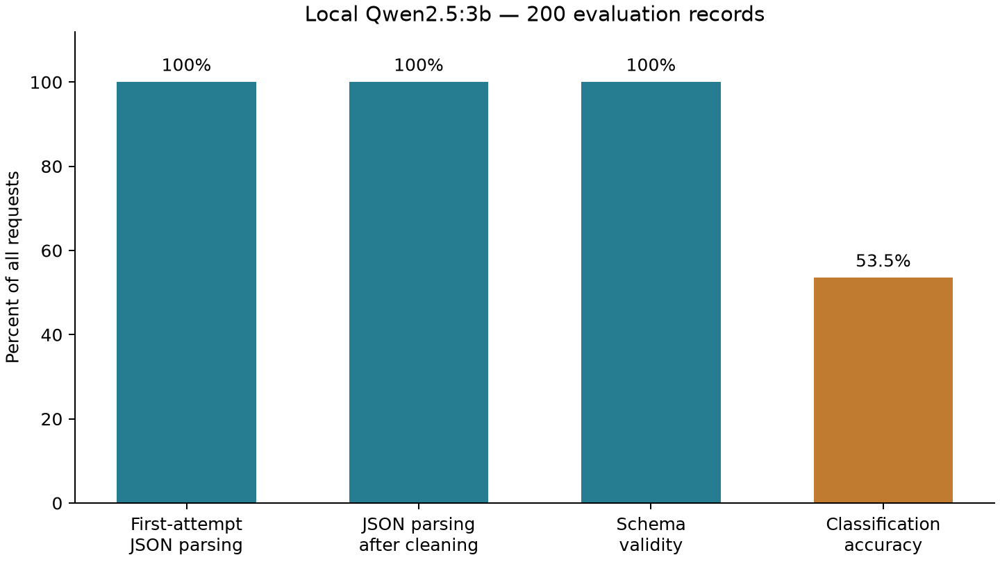

# Structured Text Classification & Information Extraction

**NLP Project I — Technical Report**

## 1. Introduction and objective

The objective is to transform unstructured Turkish news into machine-readable JSON using a local language model and Python. Each response assigns a news category and extracts person, organization and location names. The assignment emphasizes reliable structured output, explicit exception handling and a measured first-attempt JSON parsing success rate over at least 100 samples. This project evaluates 200 records and distinguishes syntactic reliability from classification correctness. No cloud LLM API, model training or fine-tuning is used.

## 2. Dataset and model

The included `data/test_samples.jsonl` is a frozen selection from the TTC4900 Turkish news dataset, identified in the original project as `savasy/ttc4900`, train split. Of 205 records, the first five were reserved for development; evaluation uses exactly `samples[5:205]`. Original IDs, texts, order and reference categories are retained. Selection used seed 42, a 150–3000 character filter and category quotas. The evaluation includes 29 records each for dunya, ekonomi, kultur and saglik, and 28 each for siyaset, spor and teknoloji. It contains 200 distinct IDs and 199 unique text strings: IDs 2138 and 2296 have identical text. Metrics are per record.

The model is the local open-source Qwen2.5:3b, served by Ollama at `http://localhost:11434/api/generate`. The preserved environment record reports Ollama version 0.40.2 and model digest `357c53fb659c5076de1d65ccb0b397446227b71a42be9d1603d46168015c9e4b`. This is historical metadata, not a new environment measurement. The original Turkish prompt, generation schema and settings were retained: temperature=0, seed=42, num_ctx=4096, num_predict=384, repeat_penalty=1.2 and repeat_last_n=128. Requests are non-streaming, with connection/read timeouts of 5/60 seconds. A seed does not guarantee identical outputs across software or model versions.

## 3. Methodology

The pipeline is: news text → Turkish task prompt → local LLM → raw JSON parsing → cleaning if needed → schema validation → reference-category comparison. `src/llm_pipeline.py` implements these steps; `src/evaluate.py` reads records, saves requests and computes metrics.

Ollama receives a JSON Schema requiring a category from the seven labels and an entities object with person, organization and location lists of strings. Both object levels reject additional fields. The prompt requests at most five names per list, no duplicates and no names absent from the article. These semantic instructions are not guaranteed by structural validation; the five-name limit is not encoded in the schema.

The first parsing operation is `json.loads(raw_output)` on the original model text. A `try-except` block catches `json.JSONDecodeError`. Only then does the cleaner remove whitespace and Markdown fences or locate the first complete JSON object among surrounding explanations. Parsing is retried, and unrecoverable output is recorded as a failure. Recovery never adds fields or closing braces. Following the original behavior, a truncated outer response can yield a complete nested object; it must still pass the full schema check. Connection, HTTP and invalid API-envelope errors are recorded so evaluation can continue. Correct classification requires both valid structure and agreement with the reference label.

Offline tests cover JSON cleaning, malformed outputs, schema/category errors, API failures, metric denominators and evidence preservation. Request tests use mocks; no new inference was executed. Run `python src/evaluate.py --analyze` for offline metrics and `python -m unittest discover -s tests -v` for tests. Fresh inference requires `--run --results NEW.jsonl`.

---

## 4. Evaluation results

The table is an offline reanalysis of the 200 previously saved raw responses in `results/optimized_schema_results.jsonl`. It is not a new inference experiment. Saved success flags are not trusted: parsing, schema validity and category correctness are independently recomputed from response text and dataset labels. The raw response file was neither renamed nor modified.

| Metric | Successful / total requests | Percentage |
|---|---:|---:|
| First-attempt JSON parsing | 200 / 200 | 100% |
| JSON parsing after cleaning | 200 / 200 | 100% |
| Schema validity | 200 / 200 | 100% |
| Classification accuracy | 107 / 200 | 53.5% |

Every rate uses `successful_count / total_requests × 100`. API failures, invalid JSON and invalid schemas remain in the denominator. First-attempt success requires direct parsing before any cleaning. Post-cleaning success includes direct successes and recovered responses; no response needed recovery in this run. Schema success measures required fields, types and allowed values, not semantic correctness. Classification accuracy counts schema-valid predictions matching their reference categories.

All 200 requests returned responses, with zero API errors. Saved measured time totals 241.83 seconds, or 1.21 seconds per record on average after rounding. This includes request waiting and local parsing, not just model computation. Reanalysis reuses these timings and does not measure a new run.

## 5. Limitations and conclusion

The 100% JSON and schema success rates demonstrate structured-output reliability for these samples; classification accuracy is only 53.5%. Valid JSON is not evidence that its content is correct. Entity extraction was performed, but semantic entity accuracy was not measured against manually annotated ground truth. No claim is made about hallucination detection. One duplicated text reduces evaluation diversity, and these findings apply to this dataset and model configuration rather than all Turkish news or language models.

**Evidence:** Dataset and response SHA-256 values are recorded in `report/evidence.sha256`. The original implementation and tracked experiments remain on `backup/pre-simplification` at commit `f970b0c9bbb622d8e5a6d3ccf5fe4aea90aca7cb`. The small implementation fulfills the course requirements while making syntax, structure and semantic accuracy separately explainable.
