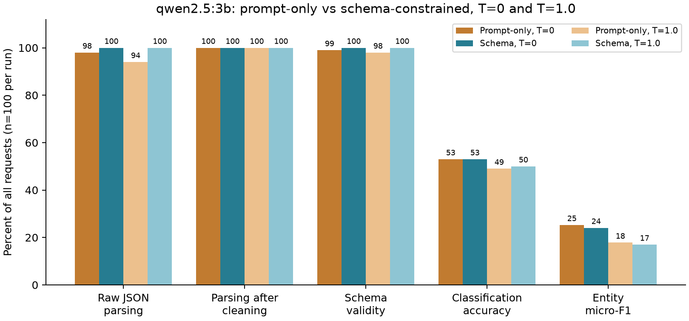

# Structured Turkish News: JSON Classification and Entity Extraction

**Evaluation complete.** Manual annotation: **100/100**. Completed requests: **400/400**.

## 1. Task and data

A local open-source Qwen model classifies Turkish news into seven categories and extracts person, organization and location names. The experiment compares prompt-only JSON instructions with Ollama JSON-schema constraints, then repeats both modes at temperatures 0 and 1. No cloud model API is used for these requests.

The fixed evaluation file contains 100 distinct TTC4900 articles: 15 dunya, 15 ekonomi, and 14 each in kultur, saglik, siyaset, spor and teknoloji. Texts, source IDs and original category labels are saved in data/news.jsonl. This balanced subset is not a random estimate of natural news prevalence. Identical texts and order are used in all four runs. Source: [savasy/ttc4900](https://huggingface.co/datasets/savasy/ttc4900).

## 2. Model and method

Model tag: **qwen2.5:3b**; quantization **Q4_K_M**; Ollama **0.40.2**; Python 3.12.3; GPU: NVIDIA GeForce RTX 3050 Ti Laptop GPU, 4096 MiB. Model digest: 357c53fb659c5076de1d65ccb0b397446227b71a42be9d1603d46168015c9e4b. Per-run metadata saves the model template, system message and environment before/after execution.

Explicit options: temperature=0, seed=42, num_ctx=4096, num_predict=1024, repeat_penalty=1.2, repeat_last_n=128, top_k=40, top_p=0.9, min_p=0, presence_penalty=0, frequency_penalty=0. Temperature is replaced by 1.0 for the temperature experiment; stream=false in all requests. Requests use the same prompt, schema and options except the controlled variable. Prompt-only omits format entirely; schema mode sends the JSON_SCHEMA object. Stop-list and runtime-default details are in docs/GENERATION_PARAMETERS.md. Reference: [Ollama structured outputs](https://docs.ollama.com/capabilities/structured-outputs).

The prompt defines categories, entity types and a JSON object template. It asks for all named surface forms without a five-name cap. The schema requires category plus person/organization/location string arrays inside entities, and disallows additional fields. Token budget is finite, so truncation remains possible and is counted as a failure when unusable.

Raw parsing applies json.loads directly. On JSONDecodeError, cleaning removes Markdown fences or surrounding text and retries. It never adds facts, fields or missing braces. Schema checking then verifies required keys, types and allowed categories. API errors are recorded and remaining samples continue. Raw outputs are preserved; summary metrics are recomputed from them.

<!-- pagebreak -->

## 3. Evaluation results

All format and classification rates divide by every request, including API/parse/schema failures. Classification counts a correct category only when the full output is schema-valid. Entity scoring treats invalid outputs as empty predictions, so missing gold names count as false negatives. Pending entity F1 is not a zero score.

| Mode / T | n | Raw JSON | Clean JSON | Schema | Accuracy | Entity F1 |
|---|---:|---:|---:|---:|---:|---:|
| prompt, 0 | 100 | 98% | 100% | 99% | 53% | 25.27% |
| schema, 0 | 100 | 100% | 100% | 100% | 53% | 24.05% |
| prompt, 1 | 100 | 94% | 100% | 98% | 49% | 17.84% |
| schema, 1 | 100 | 100% | 100% | 100% | 50% | 16.98% |

At T=0 schema changed end-to-end category accuracy by +0 percentage points. Among 99 outputs valid in both modes, 1 category predictions differed. Only prompt was correct on 0 texts, only schema on 0. A structural recovery can improve usable-output accuracy without changing category decisions on mutually valid outputs. Here, better formatting added no net correct category decisions. The schema restricts allowed forms and labels; it does not identify the reference category.

For prompt only, T=0 to T=1 changed raw parsing 98% to 94% and category accuracy 53% to 49%. For schema constrained, T=0 to T=1 changed raw parsing 100% to 100% and category accuracy 53% to 50%. These single-seed findings do not establish a universal temperature effect. The live video demonstrates both temperatures on the same new texts.

<!-- pagebreak -->

## 4. Manual annotation and entity matching

The annotation screen starts with empty fields and displays only the article and the annotator's own saved entries. The human selects or types source-text names, assigns their types and explicitly saves each article. No model suggests, completes or verifies these labels. Completed records include annotator, timestamp and source-text hash. Recorded annotator(s): **Emrehan Metin**.

Annotate all distinct named surface forms. Exclude titles, grammatical suffixes, products, events, nationalities and fictional characters. Use the longest explicit name at a mention; include a short form separately only when it occurs separately. A club or national team is an organization; a country used geographically is a location. Repeated identical forms count once. There is no entity-count cap and no alias-group syntax. Full policy: docs/ANNOTATION_GUIDELINES.md.

Matching is exact after NFC normalization, Turkish İ→i and I→ı replacement before lowercasing, underscores-to-spaces and whitespace collapsing. Entity type is preserved. Compare sets of (type, normalized surface form) within each article. A wrong type contributes FP and FN; no partial or fuzzy match is used. P=TP/(TP+FP), R=TP/(TP+FN), F1=2PR/(P+R), with zero denominators giving zero. Micro-F1 sums counts across all articles and types.

| Mode / type | Precision | Recall | F1 |
|---|---:|---:|---:|
| Prompt / location | 25% | 2.53% | 4.59% |
| Prompt / organization | 33.98% | 12.07% | 17.81% |
| Prompt / person | 53.17% | 37.33% | 43.86% |
| Prompt / micro | 44.94% | 17.58% | 25.27% |
| Schema / location | 20.83% | 1.81% | 3.32% |
| Schema / organization | 36.05% | 10.69% | 16.49% |
| Schema / person | 50% | 36.3% | 42.06% |
| Schema / micro | 44.1% | 16.53% | 24.05% |

Entity micro-F1 at T=0 is 25.27% for prompt-only and 24.05% for schema (-1.22 percentage points). Grammar constraints restrict structure and labels, but cannot guarantee correct names, types or complete extraction. This single-seed observation does not prove general superiority.

Every annotation save rebuilds metrics, plot and this report from current gold. New or changed gold changes the evaluation input; no F1 value is hard-coded. Annotation fingerprint: 6da08efe5bdf1e96b05cb6010356600518020b5796bd8215e20be16d74c6231a.

## 5. Limitations and reproduction

One annotator, one seed and a small balanced subset limit generalization. No blinded annotation or inter-annotator agreement is claimed. Exact surface matching penalizes spelling differences; finite output/context budgets can omit names. JSON validity is not semantic correctness. Runtime/hardware changes can affect reproducibility even with a fixed seed; pretraining overlap is unknown.

Run python src/build_report.py to regenerate all derived outputs without model calls. Run python src/evaluate.py --run-all --directory results/new_run for new inference. Code/report, the English video (maximum 30 minutes) and Unlisted link must be submitted according to the course instructions. Manual labels, live tests and the student's own defense cannot be replaced by generated artifacts.
