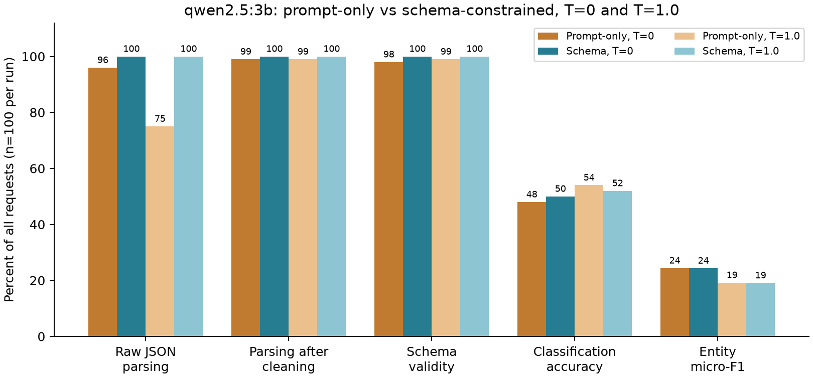

# Structured Text Classification & Information Extraction

NLP Project I — November 2026 — English submission report

**DRAFT — entity gold pending human review.** Human entity review: 0/100. Deadline: 22 November 2026, 23:59 Türkiye time.

## 1. Introduction and objective

A local Qwen LLM converts Turkish news into a category and three named-entity lists. The objective is to separate reliable JSON formatting from correct information. The primary experiment changes only Ollama's format parameter; a supplementary experiment changes only temperature within each mode. No cloud inference, training or fine-tuning is used.

## 2. Dataset, model and setup

The frozen TTC4900 file contains 205 records: five development and 200 historical evaluation records (199 distinct texts). The November evaluation selects 100 distinct texts without looking at new model outputs: scan the 200 records in stored order, skip selected duplicate texts, and fill category quotas. Alphabetically first dunya and ekonomi receive 15 each; kultur, saglik, siyaset, spor and teknoloji receive 14 each. IDs and selection rules are saved in data/evaluation_ids.json. This balanced subset is not an estimate of natural news prevalence.

Exact model tag: **qwen2.5:3b**; architecture qwen2; installed quantization **Q4_K_M**, read from Ollama /api/show and checked with ollama show. Ollama **0.40.2**; Python **3.12.3**; GPU: NVIDIA GeForce RTX 3050 Ti Laptop GPU, 4096 MiB. Linux/WSL2 environment and model template/system prompt are captured in results/environment.json. Full model digest: 357c53fb659c5076de1d65ccb0b397446227b71a42be9d1603d46168015c9e4b.

All runs use seed=42, num_ctx=4096, num_predict=384, repeat_penalty=1.2, repeat_last_n=128 and stream=false. Primary temperature=0; supplementary temperature=1.0. top_k and top_p are **not explicitly set**; runtime/model defaults apply. HTTP connection/read timeouts are 5/60 seconds. Per-run metadata captures software, model and hardware before and after execution; per-response hashes identify prompt, schema and source text.

## 3. Methodology

build_prompt() retains the Turkish task and adds a minimal explicit JSON object template (v2). This essential correction gives prompt-only mode the field names absent from v1; preserved five-record development outputs with v1 had no schema-valid response. Both new arms use identical v2 prompts and samples in the same order. Prompt-only omits the format key entirely; schema mode sends JSON_SCHEMA. The schema requires exactly category and entities, an allowed category and person/organization/location string arrays; it rejects extra fields. The prompt's five-name cap is not a schema constraint.

parse_json_response() first calls json.loads(raw_output). A JSONDecodeError triggers Markdown/explanation removal, then a second parse. No facts, missing fields or closing braces are invented. A complete nested object recovered from truncated text must still pass validate_schema(). evaluate_sample() saves the untouched raw output and records HTTP, timeout or envelope errors without stopping later samples.

<!-- pagebreak -->

## 4. Experimental results

These tables are recomputed from the fresh saved responses, not from historical success flags. All four rates divide successful records by **all 100 requests per condition**, including API, parsing and schema failures. Post-cleaning success includes direct successes and recovered responses. Correct classification requires a schema-valid output whose category equals the TTC4900 label. This is end-to-end accuracy; structural failure counts as incorrect.

| Metric | Prompt-only, T=0 | Schema, T=0 |
|---|---:|---:|
| Raw JSON parsing | 96/100 (96%) | 100/100 (100%) |
| Parsing after cleaning | 99/100 (99%) | 100/100 (100%) |
| Schema validity | 98/100 (98%) | 100/100 (100%) |
| Classification accuracy | 48/100 (48%) | 50/100 (50%) |
| Entity micro-F1 | PENDING HUMAN REVIEW | PENDING HUMAN REVIEW |

Schema decoding changed end-to-end classification accuracy by +2 percentage points on these 100 texts. Both modes were correct on 48, only prompt-only on 0, only schema on 2, and both wrong on 50. Predictions agreed on 98/100. Among 98 outputs valid in both modes, 0 category decisions differed. Separate usable-output gains from changed decisions; neither establishes a general semantic advantage.

### Controlled temperature experiment

The same 100 texts are used at both temperatures in both modes (400 requests). Seed, prompt, model and other options remain fixed within each pair.

| Mode, temperature | n | Raw JSON | Schema | Accuracy |
|---|---:|---:|---:|---:|
| Prompt, T=0 | 100 | 96% | 98% | 48% |
| Schema, T=0 | 100 | 100% | 100% | 50% |
| Prompt, T=1 | 100 | 75% | 99% | 54% |
| Schema, T=1 | 100 | 100% | 100% | 52% |

At T=0 then T=1, prompt-only raw parsing was 96% then 75%, and accuracy was 48% then 54%. Schema accuracy was 50% then 52%. These observations do not establish a general temperature effect.

<!-- pagebreak -->

## 5. Entity evaluation, discussion and limitations

TTC4900 supplies class labels, not verified entity labels. data/entity_gold.jsonl contains historical-model suggestions explicitly marked candidate. The terminal helper displays the original text, lets a human edit every list, and saves verified status only after explicit confirmation with reviewer, timestamp and source hash. Current verification: **0/100**. No entity score is released until all selected gold records are verified. Suggestions can bias review; the reviewer must also check omissions.

Match names by NFC-normalized exact equality, mapping Turkish İ to i and I to ı before lowercasing, replacing underscores with spaces and collapsing whitespace. Retain punctuation and entity type. Group explicit aliases into one gold entry; aliases must not overlap between gold entities. Deduplicate identical predictions and allow at most one prediction per gold entity. Wrong types count as FP and FN. Invalid outputs provide empty prediction sets. Per-type and micro scores use P=TP/(TP+FP), R=TP/(TP+FN), F1=2PR/(P+R); zero denominators give zero. Micro counts are summed over all texts and types before division.

Gold uses the first five distinct supported entities per type in order of first mention, keeping aliases together. This matches the output cap, but the prompt does not specify which five; alternative valid choices can lower exact-match scores. Full annotation rules cover titles, institutions, geographic names, suffixes and overlaps in docs/ANNOTATION_GUIDELINES.md.

Entity precision, recall and per-type/overall F1: PENDING HUMAN REVIEW.

Valid JSON does not prove semantic correctness. The saved predictions include sports/economy and international-politics boundary confusions; reference labels and the prompt taxonomy need not agree perfectly. Schema constraints restrict possible outputs but do not establish entity truth. Entity accuracy effects remain unknown until review is complete. A fixed seed does not remove runtime nondeterminism; temperature findings describe one realization per condition, not a universal trend. Quantization, software, hardware and prompt changes can affect reproducibility. Model pretraining overlap with TTC4900 is unknown.

Historical evidence is separate: the preserved 200-response v1 schema run achieved 200/200 raw and schema-valid outputs, 107/200 correct categories (53.5%), and no API errors. It uses a different prompt and selection, so it is not a controlled baseline for these tables. The first fresh prompt run resumed after an application restart at 35 records; provenance was checked and no saved output was replaced. Timings exclude that interruption. Earlier uncommitted partial runs remain archived, excluded from this comparison.

### Reproduction and submission status

Run python src/evaluate.py --compare to recalculate comparisons/plots, then python src/build_report.py to regenerate this report. New inference requires --run, a mode, a temperature and a new result filename; README gives exact commands. Offline tests exercise HTTP mocks only. src/demo.py sends genuine live requests on five new fictional Turkish examples; expected categories require student confirmation. Human annotation, final PDF review after F1, English recording and Unlisted YouTube upload remain student actions. The current draft does not claim assignment completion.

Dataset source recorded by the original project: [savasy/ttc4900](https://huggingface.co/datasets/savasy/ttc4900). Interface reference: [Ollama structured outputs](https://docs.ollama.com/capabilities/structured-outputs). Course page was unavailable to the agent; the user-supplied November requirements were followed. Evidence and backup details: docs/UPGRADE_EVIDENCE.md.
